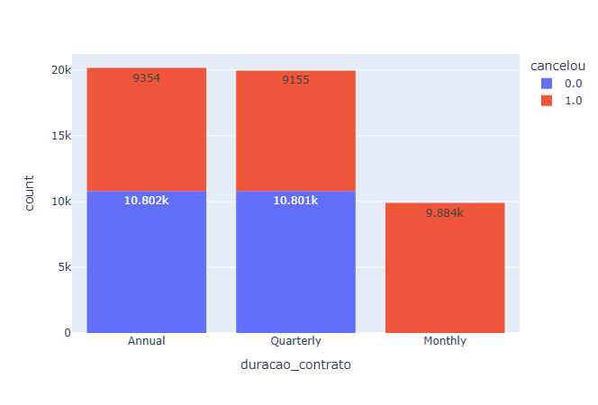
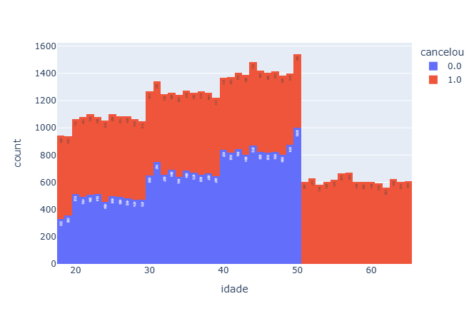
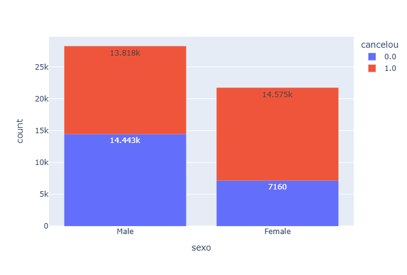
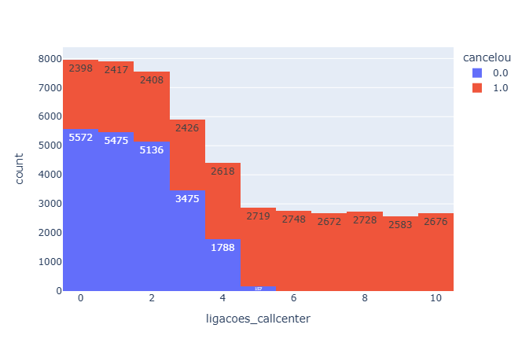
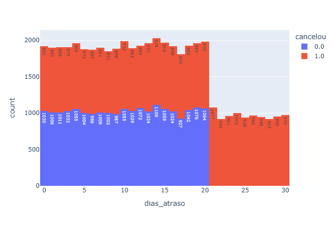
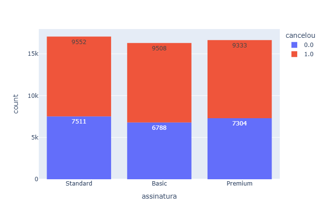

# Análise de Churn: Por que os clientes cancelam a assinatura?

> Análise exploratória de uma base de ~50.000 clientes para identificar as causas dos cancelamentos e propor ações para reduzir o churn.

## 📌 Sobre o projeto

Uma empresa com planos de assinatura **mensal, trimestral e anual** estava perdendo clientes em um ritmo preocupante. Simulando uma demanda da diretoria (CEO), este projeto explora a base de clientes para responder:

**"Por que os clientes estão cancelando e o que podemos fazer para reduzir esse número?"**

## 🎯 Objetivos

- Entender a qualidade e a estrutura da base de dados
- Quantificar quantos clientes cancelaram (taxa de churn)
- Identificar como cada variável influencia o cancelamento
- Recomendar ações práticas e eficientes para reduzir o churn

## 📂 Dados

- **Fonte:** [Base de clientes (Google Drive)](https://drive.google.com/drive/folders/1uDesZePdkhiraJmiyeZ-w5tfc8XsNYFZ?usp=drive_link). Este projeto faz parte de um case do curso da Hashtag Treinamentos.
- **Tamanho:** 49.996 clientes | _(11 colunas)_
- **Planos analisados:** mensal, trimestral e anual.
- **Principais variáveis:** duração do contrato, tipo de assinatura (basic, standard, premium), idade, sexo, ligações ao call center, dias de atraso no pagamento, meses desde a última interação.

## 🛠️ Ferramentas utilizadas

- Python (pandas, numpy)
- Plotly
- VS Code / Jupyter Notebook

## 🔍 Etapas da análise

1. **Compreensão e limpeza da base:** visualização inicial dos dados, remoção de colunas e informações irrelevantes, identificação de erros e inconsistências (nulos, duplicados, tipos de dados incorretos).
2. **Dimensionamento do problema:** contagem de clientes ativos e cancelados e cálculo da taxa de churn.
3. **Análise de causas:** avaliação detalhada de como cada coluna impacta o cancelamento, comparando o perfil de quem cancela com o de quem permanece.
4. **Recomendações:** ações sugeridas com base nos padrões encontrados.

## 📊 Principais resultados

**Visão geral:** dos 49.996 clientes, **28.393 cancelaram (56,8%)** e 21.603 permaneceram (43,2%).

### Churn por duração do contrato


| Plano | Cancelaram | Permaneceram | Taxa de cancelamento |
|---|---|---|---|
| Mensal | 9.884 | 0 | **100%** |
| Trimestral | 9.155 | 10.801 | 45,9% |
| Anual | 9.354 | 10.802 | 46,4% |

### Churn por perfil e comportamento


| Variável | Faixa | Taxa de cancelamento |
|---|---|---|
| Idade | acima de 50 anos | **100%** |

### Churn por gênero


| Gênero | Percentual de Cancelamento| 
|---|---|
| Masculino | 48,90% | **100%** |
Feminino | 66,97%


### Churn por Relacionamento call center


| Ligações CallCenter | Até 3 | Acima de 6 |
|---|---|---|
|| 41% | 100% |


### Churn por Inadimplência


| Dias em aberto | Percentual de Cancelamento| 
|---|---|
| Até 10 dias | 46,90% | **100%** |
Até 20 dias | 46,37%
Acima de 20 dias |100%


### Churn por tipo de assinatura


| Tipo de assinatura | Taxa de cancelamento |
|---|---|
| Basic | 58% |
| Standard | 57% |
| Premium | 56% |

### Principais insights

- **Todos os clientes do plano mensal cancelaram.** É o ponto mais crítico da base: o plano mensal não retém ninguém.
- **Atrito com o atendimento é um sinal forte de saída:** quem liga mais de 6 vezes para o call center cancela sempre, contra 41% de quem liga até 3 vezes.
- **Atraso no pagamento antecipa o cancelamento:** acima de 20 dias, todos cancelam.
- **Perfil de risco:** clientes acima de 50 anos e mulheres (66,97% contra 48,9% dos homens) cancelam mais.
- **O nível do plano não explica o churn:** Basic, Standard e Premium têm taxas muito próximas (56% a 58%). O problema está mais na duração do contrato e no comportamento do cliente do que no tipo de assinatura.

## 💡 Recomendações para o negócio

1. **Plano mensal:** como 100% dos clientes do plano mensal cancelaram, oferecer desconto nos contratos trimestral e anual para incentivar a migração.
2. **Call center:** acima de 4 ligações indica um problema que a empresa não está conseguindo resolver. Quando o cliente ligar pela 3ª vez, acionar o **alerta vermelho** e priorizar o atendimento com o especialista, gerente da área.
3. **Atraso no pagamento:** quando o cliente atingir 15 dias de atraso, acionar o **alerta vermelho** e intensificar a cobrança. Oferta de débito automático e cartão de crédito na contratação ajuda no controle do cliente.
4. **Segmentos de risco:** investigar por que clientes acima de 50 anos e mulheres cancelam mais, com pesquisa de satisfação e ações direcionadas.

## ✅ Conclusão

A análise mostrou que o cancelamento não é aleatório: ele se concentra em três problemas bem definidos.

1. **Contrato mensal:** 100% dos clientes desse plano cancelaram.
2. **Ligações ao call center:** clientes com mais de 6 ligações cancelaram em 100% dos casos, contra 41% entre os que ligaram até 3 vezes. Isso indica problemas que a empresa não está conseguindo resolver.
3. **Atraso no pagamento:** com mais de 20 dias de atraso, todos os clientes cancelaram.

Hoje, **56,8%** da base cancelou o serviço. Se esses três pontos forem tratados, com desconto para migrar do plano mensal para o trimestral ou anual, alerta vermelho e atendimento prioritário pelo gerente a partir da 3ª ligação, e cobrança intensificada aos 15 dias de atraso, a taxa de cancelamento **poderia cair para cerca de 18%**, uma redução de aproximadamente 39 pontos percentuais.

Esse número é um cenário ideal: ele representa o comportamento dos clientes que não apresentam nenhum dos três problemas. O resultado real dependerá da eficácia das ações, mas a análise indica com clareza onde a empresa deve atuar primeiro para reter mais clientes.

## ▶️ Como executar

```bash
git clone https://github.com/fpetena/projeto-churn.git
cd projeto-churn
pip install -r requirements.txt
jupyter notebook inicial.ipynb
```

## ⚠️ Limitações e próximos passos

- A análise mostra **associações, não causalidade**: as variáveis podem estar relacionadas entre si (por exemplo, quem tem muito atraso também pode ligar mais para o call center).
- Faixas com 100% de cancelamento devem ser verificadas quanto ao número de clientes em cada uma.
- Próximo passo: construir um modelo preditivo de churn para antecipar quais clientes têm maior risco de cancelar.

## 👤 Autor

**Felipe Petená**
[LinkedIn](https://linkedin.com/in/felipe-petena-0061793b0) | [GitHub](https://github.com/fpetena)


